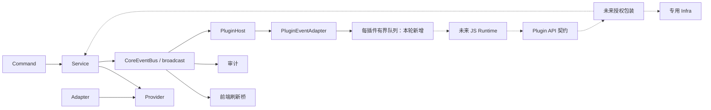

# Hinina 插件边界真实代码审计

审计日期：2026-10-19。基准提交：`d858e03`。当前施工分支：`feat/plugin-contracts`，由本地 `main` 创建；`git ls-remote --symref origin HEAD` 确认远端默认分支同为 `main`。审计在修改生产代码之前完成。用户原有 Cargo.toml 修改及未跟踪文档/图片不纳入施工提交。

## 1. 实际模块与依赖

- 前端为 View → Pinia Store → Service → Bridge → Tauri Command。提交轮询由 `submissionStore` 拥有，后端单次查询。
- Rust 为 Command → Service → Provider trait ← OJ Adapter，I/O 在 Infra；AppContext 为组合根，注入 Storage、HttpClient、ConfigService、SessionRepository、各 Service 和 PluginHost。
- `core/event/{core_event,core_event_bus,consumer}.rs` 是唯一事实通知底座。`main.rs` 启动前端桥、审计、PluginHost 三类平级消费者。
- `plugin/api/event.rs` 定义独立插件协议；host 中的 adapter 白名单裁剪，host 管理订阅。runtime、registry、permission 以及 contest/problem/workspace/ui API 多为注释占位。

## 2. 已实现的行为

- CoreEventBus 确实是 Tokio broadcast，容量 1024；publish 同步非阻塞，无 receiver 只记 debug，不回滚业务。
- `spawn_consumer` 同步创建 receiver，启动/重启时 Resync；Lagged(n) 调同步 resync 回调后继续；Closed 正常退出；worker panic 有退避和重启上限。resync 自身的 panic 不在 worker 隔离范围内。
- SubmissionCreated 仅携带 submission_id；SubmissionJudged 携带 submission_id 和 String status。稳定字符串由 JudgementStatus::as_str 提供。Pending/Compiling/Running 外视为终态。Service 每次查询到终态都会发布，允许重复；详情查询本身不发布此事件。
- PluginEvent 包含 OJ、比赛、公告、题目、提交、工作区、配置、主题、会话和 Resync 通知；不含 TokenRotated。登录仅投影 OJ ID，公告只给新增数量，工作区不带路径/源码。
- PluginEventEnvelope 为 version/sequence/occurredAt/event；旧协议版本 1、snake_case tag、camelCase 字段。sequence 每订阅从 1 起，重订阅重置；occurredAt 实际为适配时刻而非业务事实发生时刻。
- Host 在 AppContext 初始化，由 main 调 start；支持 subscribe/unsubscribe，初始 Resync(lost=0)，Lagged 时再次提示。消费者只捕获订阅表，避免持有 Host/Bus 强引用环。

## 3. 未实现能力与代码/文档差异

- 没有 JS/WASM 引擎、目录发现、代码加载、PluginManager 或业务插件。FsPluginRepository 的三个方法是 todo!，不是可用仓库。
- PluginManifest 缺少 manifestVersion/apiVersion/runtime/entry/events/network 等字段和验证；权限只有少数枚举。
- 没有可执行 Plugin API。事件订阅仅检查 Manifest 中 Notification，既未区分通知与事件，也未区分声明和宿主授权。
- 任意同步 PluginEventSink 在循环逐个调用；无界 mpsc 实现存在内存增长风险。锁外调用只避免锁重入死锁，不能隔离阻塞或 panic；现有失败测试只验证关闭通道。模块文档/todo 宣称的单插件异常隔离过强。
- 开发手册 7.3 描述 start 扫描加载，与实际仅启动消费者不符；文档的点分事件名与实际 snake_case 序列化不一致。
- core/repository/plugin_repo 反向依赖 plugin/host/manifest，违反预期分层。

## 4. 提交查询与安全投影

SubmissionService 已有 get_submission_detail、list_contest_submissions、get_judgement、测试点查询。列表是分页，支持 only_mine、展示题号和 OJ 原始状态码过滤；only_mine=true 目前由 Command 强制，Service 不会替调用方强制。

详情含源码、错误、判题机等，不能直接暴露；详情没有 contestId。列表有真实 pid、展示 display_id、用户名、秒级提交时间、状态，但同样没有直接可投影的完整作用域。当前用户查询返回 Session/User 都包含 token，必须另做最小投影。

未来 API 需返回 submissionId/contestId/problemId/problemDisplayId/status/submittedAt（毫秒），不含源码、用户名、token、评测点或原始响应。作用域由宿主绑定，而非信任插件指定用户。仅凭提交事件中的 ID 不能跨 OJ/账号安全查询；未来执行器必须在上下文变化时使旧请求失效。

## 5. 不能破坏的约束

保留唯一 CoreEventBus；不把事实事件变成核心命令；不依赖通知完成持久化、清缓存或提交；不暴露 CoreEvent/Receiver/AppContext/Service/Session。插件协议与内部实体独立。允许重复和丢失，查询为真值，Resync 不代表重放。外围业务不影响竞赛客户端正确性。

现有 HttpClient 开启 cookie_store，不能被未来插件 HTTP 复用。HTTP 安全需处理 DNS/IPv6/重定向/代理，hostname 白名单本身不构成 SSRF 防护。Tokio timeout 也不能中断 JS 死循环。

## 6. 参考设计的改进与兼容风险

- 统一点分名，事件协议升至 2；Manifest/API 版本仍从 1 开始，不增加 runtimeVersion。没有已加载插件路径，因此不维护旧格式。
- 用宿主管理的有界队列替代用户 sink；满或关闭即注销，重连先 Resync。无需复杂监督/暂停状态机。
- 分页列表必须明确不完整性；近期扫描不保证历史首次 AC。相同时间戳需要稳定第二排序键，未知历史时不派发。
- 示例失败标记无法再 CAS(null)，dispatching 崩溃后也可能永久卡住。未来业务需显式可恢复状态、有限重试和外部幂等键；本地 CAS 不能保证远端 exactly-once。
- 不实现示例插件，不引擎选型落地，不添加网络/存储执行器；契约文档不得宣称安全执行能力已经具备。

## 7. 推荐新增与修改

新增：Manifest/权限测试，Plugin API 安全契约及错误/DTO，运行时 trait，插件接口总览、Manifest 规范、API/安全说明、TypeScript 声明与使用教程。

修改：plugin/host 的 manifest、event_adapter、plugin_host；plugin/api/event 及测试；permission/runtime/registry 占位；迁移 core 的插件仓库接口到 plugin/registry，调整 infra 文件仓库；main 处理防重复启动结果；同步开发手册、Architecture、todo、模块文档。无需重写 SubmissionService、认证、比赛或工作区。

## 8. 分层实施及验证

0. 本报告先落地，再修改生产代码。
1. 协议/Manifest：点分名、版本、纯清单验证和回归测试。
2. API/Permission：独立安全 DTO、能力 trait、授予权限和稳定错误；无生产执行器。
3. Host：有界队列 128、过滤后编号、初始 Resync、背压注销、原子注册、防重复启动及集成测试。
4. 接入契约：插件仓库分层修正、占位不 panic、非 Send 引擎可接入的 Runtime trait；无 Manager 状态机。
5. 文档/验收：能力状态表、声明、教程、后续引擎验证清单；逐层测试，最终全量 Rust/前端测试、build、rustfmt、clippy。

审计基线：`cargo test --offline --manifest-path src-tauri/Cargo.toml --lib plugin::` 21/21 通过；`npm run build` 通过。现有告警：FsPluginRepository.storage 未读，Vite 大资源包。完整运行时/存储/HTTP/气球集成测试不属于本轮验收。
