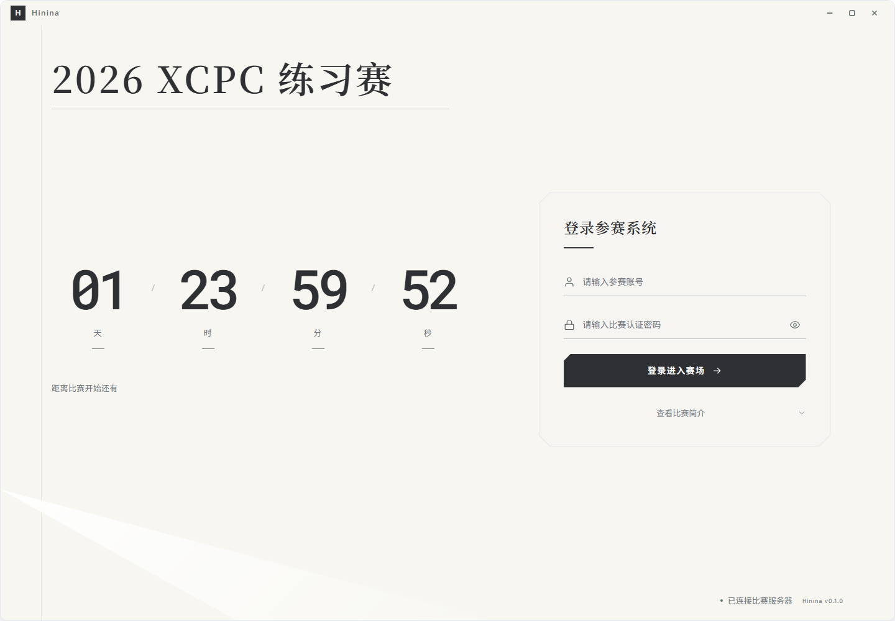
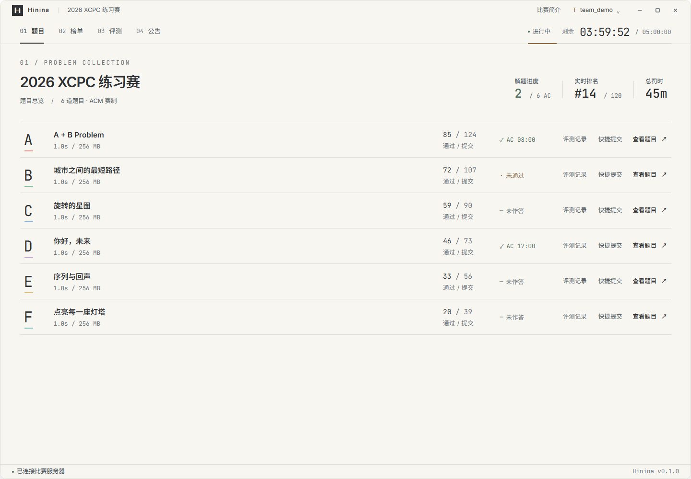
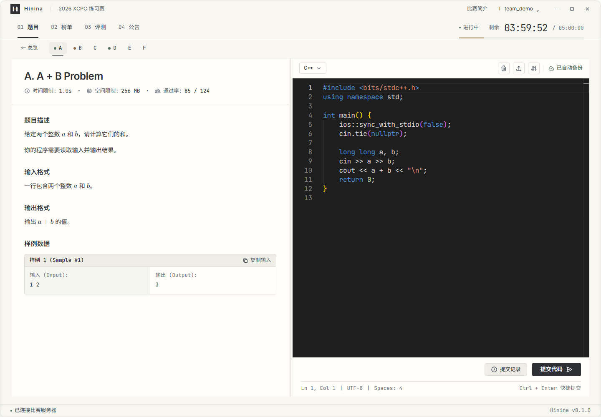
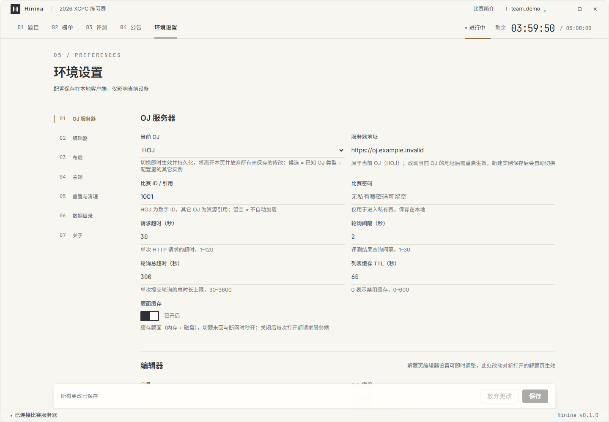

# Hinina

Hinina 是一个面向XCPC竞赛的桌面客户端。它把登录、题目、代码编辑、提交、榜单和公告放在同一个比赛工作台里，比赛时不用在浏览器标签页之间来回切换。

项目目前仍在开发中，界面和配置格式可能继续调整。当前仓库没有发布稳定版安装包，想试用的话需要从源码构建。

## 界面一览

下面的图片使用的是仓库内的演示数据，账号、比赛和题目名称均为虚构内容。



登录页会显示比赛标题和倒计时。登录成功后，客户端会根据比赛阶段决定是否进入工作台。



题目总览展示通过数、提交数和个人状态。每道题的题号下方会保留比赛设置的颜色，也可以从这里直接打开题目或快捷提交。



解题页左侧是题面，右侧是代码编辑器。提交后，评测状态会在当前页面更新。



设置页默认隐藏。进入比赛工作台后，连续点击右下角的版本号 5 次，顶部导航会出现“环境设置”；重启客户端后需要重新点击解锁。

## 现在能做什么

- 连接 HOJ 或 Hydro 实例，保存多个 OJ 实例并在设置页切换
- 登录、恢复会话和退出登录
- 查看比赛题目、时间限制、空间限制和个人做题状态
- 在内置 Monaco 编辑器中写代码，选择语言并自动保存工作区
- 提交代码并轮询评测结果，查看提交历史、提交详情和测试点
- 查看 ACM/OI 榜单、比赛公告和未读状态
- 在比赛结束后保留本地工作区和提交源码留档
- 调整 OJ 服务器、比赛引用、编辑器字体、Tab 宽度、编辑器主题、自动保存间隔和本地数据目录

客户端界面目前固定为浅色主题；解题页的编辑器可以单独切换主题。

## 环境设置

解锁设置页后，可以在左侧分组之间切换：

- **OJ 服务器**：选择当前 OJ、填写服务器地址和比赛 ID / 引用，设置请求超时、评测轮询间隔、轮询总时长和题面缓存
- **编辑器**：设置默认语言、字号、Tab 宽度、自动保存开关和自动保存间隔
- **布局**：调整解题页左右分栏比例
- **主题**：选择界面主题（当前版本固定浅色）和编辑器主题
- **重置与清理**：重置可重新获取的缓存，预览并清理日志、过期提交源码留档
- **数据目录**：查看或更改本地数据目录；可以选择是否迁移现有工作区、提交留档、配置和会话
- **关于**：查看客户端版本、存储目录和日志路径

保存设置后，大部分选项立即生效。OJ 地址和数据目录的更改需要重启客户端；更改当前 OJ 后会回到登录页，由新 OJ 的会话重新进入比赛。

## 支持的 OJ

仓库内建并已接入的适配器是：

- [HOJ](https://github.com/HOJ-Inc/HOJ)
- [Hydro](https://github.com/hydro-dev/Hydro)

不同 OJ 的登录方式、题目编号和评测状态由适配器处理，工作台使用统一的数据结构。实际可用的功能还取决于服务器版本和比赛配置。

## 开始开发

### 环境

- Node.js 和 npm
- Rust 工具链（`rustup`、`cargo`）
- Tauri 2 的系统依赖
- C 编译器（插件运行时 `rquickjs` 会在构建时编译内置的 QuickJS C 源码）

在 Windows 上还需要安装 WebView2 和 Visual Studio C++ 构建工具（其中的 MSVC 即所需的 C 编译器；当前真实引擎测试在 `x86_64-pc-windows-msvc` 上验证）。Linux/macOS 需要 `gcc` 或 `clang`；这两个平台的插件运行时尚未做构建验证。其他系统依赖请按 [Tauri 官方文档](https://v2.tauri.app/start/prerequisites/) 配好。

### 安装依赖

```bash
npm ci
```

### 启动前端开发服务器

```bash
npm run dev
```

只调试 Vue 页面时可以使用这个命令，默认地址是 `http://localhost:1420`。

### 启动桌面应用

```bash
npm run tauri dev
```

### 构建和测试

```bash
# 前端类型检查和生产构建
npm run build

# 前端单元测试
npm test

# Rust 单元测试
cargo test --manifest-path src-tauri/Cargo.toml

# 构建 Tauri 安装包（Windows 目标为 NSIS）
npm run tauri build
```

## 项目结构

```text
src/                  Vue 页面、组件、Pinia stores、服务和 IPC bridge
src-tauri/src/core/   领域实体、Provider 接口和事件
src-tauri/src/service/业务编排、缓存和工作区管理
src-tauri/src/adapter/HOJ、Hydro 等 OJ 的协议适配
src-tauri/src/infra/  HTTP、文件存储、日志和本地缓存
src-tauri/src/commands/Tauri IPC 命令
doc/                  架构说明、开发手册和界面设计稿
```

前端调用保持 `View → Store → Service → Bridge` 的顺序；文件和网络操作放在 Rust 侧，OJ 的差异收敛在 adapter 层。

## 本地数据

工作区代码、提交源码快照、配置、会话和日志默认保存在应用数据目录。可以在「设置 → 数据目录」中改位置，也可以在「设置 → 本地数据」中清理缓存或过期的提交留档。提交源码快照用于在 OJ 没有返回源代码时查看当时提交的版本。

## 启动参数

正式版（release）启动时不带控制台窗口；需要现场排障时可以从终端带 `--console` 启动，日志与崩溃信息会同时输出到该控制台，日志同时写入数据目录下的 `logs/hinina.log`。程序崩溃（panic）的消息与完整堆栈会自动落盘——写入临时目录的 `hinina-panic.log`（不经 `RUST_LOG` 过滤，也不依赖日志文件是否可用；仅临时目录不可写时无法落盘），日志文件可写且未被 `RUST_LOG` 关闭时同时写入 `logs/hinina.log`。**启动阶段**的不可恢复错误（后台运行时创建、数据目录初始化、窗口/WebView2 创建失败）会在崩溃记录落盘后弹出系统错误框，关闭后退出，不再表现为“双击无反应”。日志级别默认 info，可用环境变量 `RUST_LOG` 覆盖（如 `RUST_LOG=debug`）。

## 许可证

[MIT](LICENSE)
