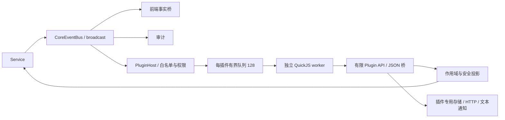

# Hinina 外围 JavaScript 插件宿主

本轮提供可运行的最小宿主，Manifest **2**、Plugin API **2**、事件协议 **2**。不包含气球插件、首次 AC 判断、外部服务的重试业务或完整管理界面。

| 层 | 实现 |
|---|---|
| core/service | 显式 AccessRevision；只读身份、比赛和本人提交历史；不读取源码 |
| plugin/api/permission | 独立 DTO、错误白名单、宿主授权快照 |
| plugin/query/execution_api | 作用域签发、游标分页、权限校验、有限 JSON 桥 |
| infra | 文件仓库、atomicwrites + fs4 JSON/CAS、reqwest 网络、纯文本通知 |
| plugin/runtime | rquickjs 0.14；独立引擎、Promise、中断、内存和时间限制 |
| plugin/manager | 启动、停止、重载、状态、手动/定期 Resync |
| commands/frontend | 开发命令与 dev 控制台助手、文本通知出口 |

Host 不执行用户回调、不建立第二套业务总线。Manager 才拥有生命周期；AppContext 只持有 Send 控制器，JS 值留在 worker。worker 使用持续存在的 Tauri Tokio handle，不使用启动临时运行时。

从[开发教程](tutorial.md)开始。另见 [Manifest](host/manifest.md)、[API](api/mod.md)、[事件与 Resync](api/event.md)、[安全模型](security.md)、[Runtime](runtime/mod.md)、[验证记录](validation.md)。[真实代码审计](../../../../ARCHITECTURE_REVIEW.md)保留上一轮和本轮基线。
