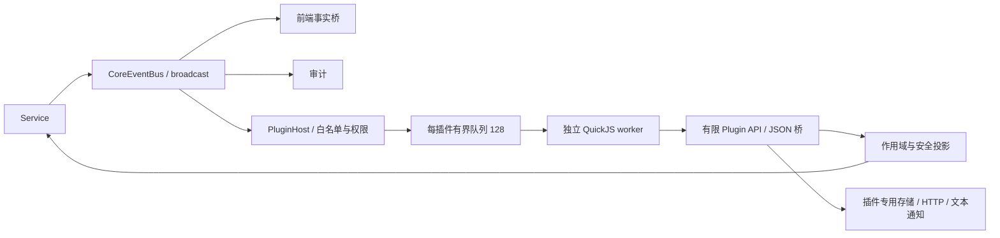

# Hinina 外围 JavaScript 插件宿主

> 模块总览（索引）。当前交付最小可运行宿主：Manifest **2**、Plugin API **2**、事件协议 **2**。宿主不包含首次 AC 判断、外部服务的重试业务或完整管理界面——业务规则留在插件侧，参考实现见 [sdk/examples/balloon](sdk/examples/balloon/README.md)（首次 AC 气球派发，不构建进应用）。

## 分层

| 层 | 实现 |
|---|---|
| core/service | 显式 AccessRevision；只读身份、比赛和本人提交历史；不读取源码 |
| plugin/api/permission | 独立 DTO、错误白名单、宿主授权快照 |
| plugin/query/execution_api | 作用域签发、游标分页、权限校验、有限 JSON 桥 |
| infra | 文件仓库、atomicwrites + fs4 JSON/CAS、reqwest 网络、纯文本通知 |
| plugin/runtime | rquickjs 0.14；独立引擎、Promise、中断、内存和时间限制 |
| plugin/manager | 启动、停止、重载、状态、手动/定期 Resync |
| commands/frontend | 开发命令与 dev 控制台助手、文本通知出口 |

关键原则：Host 不执行用户回调、不建立第二套业务总线；Manager 才拥有生命周期；AppContext 只持有 Send 控制器，JS 值留在 worker；worker 使用持续存在的 Tauri Tokio handle，不使用启动临时运行时。

## 模块文档

- 入口：[plugin 模块](mod.md)
- 能力面：[API 规范](api/mod.md)、[事件与 Resync](api/event.md)、[错误契约](api/error.md)
- 宿主机制：[Manifest](host/manifest.md)、[PluginHost](host/plugin_host.md)、[事件适配](host/event_adapter.md)、[错误适配](host/api_error.md)
- 内核机制：[查询边界](query.md)、[执行桥](execution_api.md)、[资源上限](limits.md)、[有界 JSON](bounded_json.md)、[授权快照](permission/mod.md)、[仓库端口](registry/mod.md)
- 执行与生命周期：[Runtime](runtime/mod.md)、[QuickJS 细节](runtime/quickjs.md)、[Manager](manager.md)
- 专题：[安全模型](security.md)、[开发教程](tutorial.md)、[验证记录](validation.md)

## 直接依赖（Cargo.toml）

均为插件宿主服务：`rquickjs`（JS 引擎，构建需 C 编译器）、`atomicwrites` + `fs4`（插件私有 JSON 的原子写与跨实例锁）、`governor`（令牌桶限流）、`semver`（清单与最低版本校验）、`sha2`（存储命名空间与身份键哈希）、`uuid`（句柄/游标不透明 ID）、`url` + `ipnet` + `ip_network`（精确 origin 与地址策略）、`tokio-util`（取消令牌）；dev-dependency 为 tokio `test-util`（虚拟时间）。

## 相关入口

- 顶层设计/契约/施工/路线图/历史：[doc/plugin/](../../../plugin/README.md)
- 阶段成果与已知缺口：[路线图](../../../plugin/roadmap.md)（当前仍采用开发命令和宿主配置）
- 历史与关键修复：[history.md](../../../plugin/history.md)
- 从[开发教程](tutorial.md)开始
