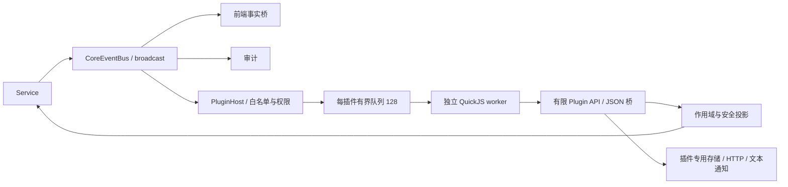

# Hinina 外围 JavaScript 插件宿主

本轮提供可运行的最小宿主，Manifest **2**、Plugin API **2**、事件协议 **2**。不包含气球插件、首次 AC 判断、外部服务的重试业务或完整管理界面。

| 层 | 实现 |
|---|---|
| core/service | 显式 AccessRevision；只读身份、比赛和本人提交历史；不读取源码 |
| plugin/api/permission | 独立 DTO、错误白名单、宿主授权快照 |
| plugin/query/execution_api | 作用域签发、游标分页、权限校验、有限 JSON 桥 |
| infra | 文件仓库、atomicwrites + fs4 JSON/CAS、reqwest 网络、纯文本通知 |
| plugin/runtime | rquickjs 0.14；独立引擎、Promise、中断、内存和时间限制 |
| plugin/manager | 启动、停止、重载、状态、手动/定期 Resync |
| commands/frontend | 开发命令与 dev 控制台助手、文本通知出口 |

Host 不执行用户回调、不建立第二套业务总线。Manager 才拥有生命周期；AppContext 只持有 Send 控制器，JS 值留在 worker。worker 使用持续存在的 Tauri Tokio handle，不使用启动临时运行时。

顶层入口见 [doc/plugin/README.md](../../../plugin/README.md)：[架构](../../../plugin/architecture.md)、[统一契约](../../../plugin/contracts.md)、[开发与施工](../../../plugin/development.md)、[路线图](../../../plugin/roadmap.md)、[历史](../../../plugin/history.md)。

从[开发教程](tutorial.md)开始。另见 [Manifest](host/manifest.md)、[API](api/mod.md)、[事件与 Resync](api/event.md)、[安全模型](security.md)、[Runtime](runtime/mod.md)、[验证记录](validation.md)。

阶段成果、已知缺口、改进优先级和后续管理界面/操作语义见[路线图](../../../plugin/roadmap.md)；当前仍采用开发命令和宿主配置。

新增直接依赖（均为插件宿主服务，见 Cargo.toml）：`rquickjs`（JS 引擎，构建需 C 编译器）、`atomicwrites` + `fs4`（插件私有 JSON 的原子写与跨实例锁）、`governor`（令牌桶限流）、`semver`（清单与最低版本校验）、`sha2`（存储命名空间与身份键哈希）、`uuid`（句柄/游标不透明 ID）、`url` + `ipnet` + `ip_network`（精确 origin 与地址策略）、`tokio-util`（取消令牌）；dev-dependency 为 tokio `test-util`（虚拟时间）。

内部实现的执行期限与字节预算见 [limits](limits.md)，流式输出限制见 [bounded_json](bounded_json.md)。

[历史与关键修复](../../../plugin/history.md)按里程碑记录结论；[QuickJS细节](runtime/quickjs.md)补充引擎与错误契约。
