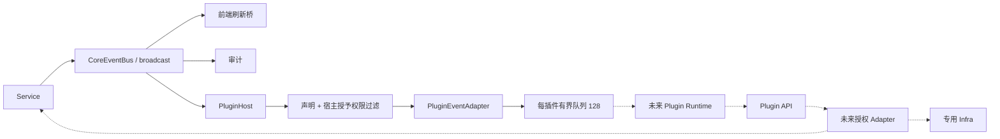

# Hinina 插件接口与事件边界

当前交付是接口预留，不支持安装或运行 JS 插件。真实基线见 [架构审计](../../../../ARCHITECTURE_REVIEW.md)。

| 状态 | 能力 |
|---|---|
| 已实现 | Manifest 纯验证、版本化事件/安全投影、宿主授予权限、白名单与订阅过滤、有界队列、Resync、安全错误映射 |
| 仅契约 | 提交/比赛/身份查询、存储/CAS、HTTP、通知、Runtime/Runtime Bridge、仓库端口 |
| 未实现 | JS/TS 执行、目录发现/入口读取、授权 UI、API Adapter、上下文签发/失效、私有持久化、网络安全执行器、通知前端出口 |
| 远期草案 | 工作区读写、UI/编辑器扩展、WASM |

没有 plugins/balloon-first-ac 实现，没有 PluginManager、多阶段生命周期或第二套业务总线。本轮不新增引擎依赖。

## 模块与数据流

main.rs 在 Tokio 上下文启动 Host 消费者；start 不发现或加载插件。Host 只调用非阻塞 try_send；队列满/关闭注销单个订阅，其他订阅和业务发布方继续运行。接收端取到 None 后，未来 worker 应释放 Runtime；不能继续用旧缓存执行副作用。授权变化由宿主显式注销、使旧上下文失效，再使用新授权接入。

## 开发入口

- [Manifest 规范](host/manifest.md)：清单字段、权限、网络策略、版本语义。
- [事件协议和 Resync](api/event.md)、[Host 接入](host/plugin_host.md)。
- [Plugin API](api/mod.md)、[安全模型与日志](security.md)。
- [Runtime 与生命周期](runtime/mod.md)、[仓库端口](registry/mod.md)。
- [插件开发教程](tutorial.md)、[TypeScript 声明](sdk/hinina.d.ts)。声明是规范草案的可检查表达，不是已发布 SDK。

Rust 模块/公共类型/公共方法使用 @plugin-module / @plugin-api、@since、@permission（有能力要求时）、@stability 和安全投影的 @security 标注。事件 API/示例使用对应 JSDoc。编译期 Rust 模块可见性不是恶意原生插件的沙箱，本轮目标是未来仅注入有限能力的 JS 环境。

## 验证与后续

每层相关测试通过后再推进，最终结果见 [验证记录](validation.md)。后续按 API Adapter → 专用 Infra → 引擎验证 → 简单加载/停止 → 业务集成推进；不因为预留 trait 就声称安全执行已经完成。
