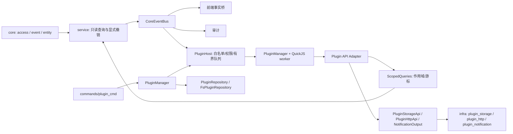

# 插件系统架构

> 基线：`main@8379772`。契约细节见 [contracts.md](contracts.md)，施工步骤见 [development.md](development.md)。

## 1. 定位与边界

插件系统是**外围能力扩展**，不是 IDE、代码编辑器平台或插件市场。宿主只负责：

- 加载经宿主批准的单个离线 ES module；
- 在隔离的 QuickJS 引擎中执行；
- 按权限和事件白名单投递事实通知；
- 提供受限的只读查询、私有存储、受控 HTTP 和纯文本通知；
- 管理插件的启动、停止、重载和重新同步。

宿主**不负责**：首次 AC 判定、气球派发、外部服务重试、业务幂等、插件管理 UI、安装/更新/市场、WASM、UI 扩展、OS 级进程沙箱。

## 2. 分层与依赖方向



| 层 | 职责 | 关键约束 |
|---|---|---|
| `core/access` | 通用 `AccessRevision` 与在途取消 | 显式调用，不依赖事件；转换期间无快照 |
| `core/event` | 唯一 `CoreEventBus` | 只发布事实，不做控制路径 |
| `service` | 只读身份/比赛/本人提交历史；登录、配置、比赛、OJ 变更显式撤销 | 不依赖 plugin；不暴露源码/Token |
| `plugin/api` | 安全 DTO、能力 trait、错误白名单 | JS 不持有内部实体/Service |
| `plugin/permission` | 声明与宿主批准取交集 | 默认拒绝，批准在代码目录外 |
| `plugin/query` | 作用域句柄、游标、只读投影 | 绑定实际 endpoint + 用户 + 比赛 + revision |
| `plugin/execution_api` | 能力装配与有限 JSON 桥 | 逐调用鉴权、准入限流、响应上限 |
| `plugin/host` | 唯一插件事件消费者、白名单、128 有界队列 | 不执行用户代码 |
| `plugin/runtime` | QuickJS 引擎、Promise、中断、内存限制 | 每插件独立 worker；`!Send` 端口 |
| `plugin/manager` | 启停/重载/状态/Resync/回收 | 生命周期串行化，失败隔离 |
| `plugin/registry` | `PluginRepository` 端口与审批结构 | 仓库实现只在 infra |
| `infra/fs_plugin_repo` | 读取 `plugins.json`、扫描代码目录、校验清单 | 代码/授权/数据分离 |
| `infra/plugin_*` | 存储、HTTP、通知、诊断 | 实现 plugin 端口，方向 `infra → plugin` |
| `commands/plugin_cmd` | 5 个开发命令 | 不接收权限、代码、URL 或路径 |
| 前端 | View → Store → Service → Bridge | Store 只存状态；Service 管通知策略 |

**硬性依赖规则**：

- `core/`、`service/` 不引用 plugin（唯一例外是组合根 `core/context.rs` 持有 plugin 类型）。
- `plugin/` 非测试代码不引用 `crate::infra`；具体 I/O 通过端口注入。
- `infra → plugin` 单向；业务 Service 不导入插件专用 Infra。
- 前端禁止跨层：View 不直接调 Service/Bridge，Store 不发网络请求，Bridge 是唯一 `@tauri-apps/api` 入口。

## 3. 数据流

### 3.1 事件路径

```
CoreEventBus (broadcast, 容量 1024)
  → PluginHost（唯一插件消费者）
  → PluginEventAdapter（白名单 + 裁剪 + 脱敏 + 版本化）
  → 每插件 mpsc 队列（128）
  → QuickJS worker（串行 handler）
```

- 事件是**提示**，不是控制流；查询结果才是真值。
- 队列满或关闭即注销该插件订阅；重新接入先发初始 Resync。
- 不存在第二套业务事件总线；内部 Service 不互相订阅。

### 3.2 查询路径

```
JS context.current()
  → ScopedQueries.current_context()
  → AccessRevision 快照 + 实际 Provider endpoint + 稳定用户 + 比赛
  → 不透明句柄
JS submission.list(context, query)
  → 逐调用校验句柄/权限/取消
  → Service 只读方法
  → Provider
JS contest.problems / contest.rank(context, query)
  → 逐调用校验句柄/权限（rank 需 contest.rank ∩ contest.read）/取消
  → ContestService.list_problems / get_rank（不选中比赛、不加缓存）
  → Provider
```

- 登录/登出/会话失效、切 OJ、换比赛、连接配置变化显式递增 revision 并取消在途调用。
- 旧句柄、旧游标、旧授权一律失效；切走再切回也不会复活。
- 查询只返回本人可见元数据；不读源码、题面或评测点。榜单是唯一的全场数据出口：
  行经 `teamKey`（与 `identity.userKey` 同算法）脱敏，不透出 uid/realname/avatar 等原始字段。

### 3.3 I/O 路径

```
JS storage.*   → PluginStorageApi → infra/plugin_storage（fs4 + atomicwrites + CAS）
JS http.request → PluginHttpApi → infra/plugin_http（独立 reqwest + origin/地址策略）
JS notification.* → NotificationOutput → infra/plugin_notification → Tauri 事件 → 前端
JS log.*       → LogApi（execution_api 内实现）→ tracing → logs/hinina.log
```

所有 I/O 都在 Rust；插件不获得文件路径、Cookie、Token、进程或任意网络能力。日志出口不经 infra 端口：它只写宿主自己的日志文件，不读宿主数据，因此直接复用宿主 tracing 管道。

## 4. 生命周期

状态只有四种：`starting`、`running`、`stopped`、`failed`。

| 操作 | 行为 |
|---|---|
| `start` | 读取并校验清单/审批 → 创建独立 worker/引擎 → activate（10s）→ 成功后建立事件订阅并投递初始 Resync |
| `stop` | 撤销授权与在途调用 → 注销订阅 → 放弃缓存事件 → 等待 worker 退出（5s）→ `stopped`；超时保持 `failed/timeout` 并由 reaper 回收 |
| `reload` | 先停旧实例并确认退出，再重新读取代码/配置/审批并启动；旧 worker 未退出前拒绝同 ID 重启 |
| `resync` | 入队一条 `resync.required`；成功只代表提示已入队，不承诺业务完成 |
| 应用退出 | 只做同步撤销，不等待插件，不干预工作区保存 |

生命周期串行化；单插件失败不影响其他插件或核心。启动超时与 stop 超时都采用 fail closed，迟到退出不能覆盖已锁定的失败诊断。

## 5. 数据布局

```text
<base_dir>/
  plugins.json                         # 宿主审批，位于代码目录之外
  plugins/<plugin-id>/
    manifest.json
    index.js                           # 离线打包的 ES module
  plugin-data/<sha256(plugin-id)>/
    storage.json                       # 插件私有 JSON
```

- 代码默认在 `plugins/<id>/`，可由管理员通过 `codeRoot` 指向其他根目录。
- 审批与代码分离；没有 `plugins.json` 时默认不启用任何插件。
- 数据目录名是插件 ID 的 SHA-256；停止、禁用、卸载代码都不删除数据。
- 授权文件、代码、数据三者分离，插件不能指定真实文件路径。

## 6. 安全模型

1. **声明 ≠ 授权**：有效权限 = Manifest 声明 ∩ `plugins.json` 批准；默认拒绝，清单变更不会自动扩权。
2. **访问作用域**：`AccessRevision` 显式撤销，不依赖有损事件；转换期间 `snapshot()` 为 `None`。
3. **网络**：精确 origin（仅域名，拒绝 IP 字面量）；全部 DNS 结果过地址策略后固定连接；无代理/跳转/重试/Cookie/宿主凭证；私网 CIDR 与明文 HTTP 需单独批准。
4. **执行隔离**：每插件独立引擎/线程，16MiB 堆、256KiB 栈、activate 10s、事件 30s；同步死循环由引擎中断，未完成 Promise 由取消和时间上界终止。
5. **错误与日志**：JS 只收到 11 个稳定错误码；日志不记录 URL、凭据、请求/响应正文、路径、JS 栈或 panic payload。
6. **进程内隔离不等于 OS 沙箱**：native 缺陷或进程崩溃仍可能影响应用；已发送 HTTP 和已完成的文件写不能回滚。

## 7. 关键设计取舍

- **事件是事实，查询是真相**：Resync 只提示重查，不重放事件；插件不能凭事件 ID 直接派发副作用。
- **不建立第二套总线**：所有业务事实仍来自 `CoreEventBus`；`PluginHost` 只是消费者。
- **有界优先**：队列、句柄、游标、桥调用、存储、HTTP、通知、状态历史都有硬上限。
- **业务留在插件**：首次 AC 定义、历史完整性、跨页去重、外部幂等、重试/恢复由插件负责；核心 `SubmissionService` 不加入这些规则。
- **先闭环再扩大分发**：当前是“作者/维护者参与的开发模式”，不是“终端用户可自行安装”的产品模式。

## 8. 模块索引

| 模块 | 文档 |
|---|---|
| `plugin/api` | [api/mod.md](../modules/src-tauri/plugin/api/mod.md) |
| `plugin/permission` | [permission/mod.md](../modules/src-tauri/plugin/permission/mod.md) |
| `plugin/registry` | [registry/mod.md](../modules/src-tauri/plugin/registry/mod.md) |
| `plugin/query` | [query.md](../modules/src-tauri/plugin/query.md) |
| `plugin/execution_api` | [execution_api.md](../modules/src-tauri/plugin/execution_api.md) |
| `plugin/host` | [host/mod.md](../modules/src-tauri/plugin/host/mod.md) |
| `plugin/runtime` | [runtime/mod.md](../modules/src-tauri/plugin/runtime/mod.md) |
| `plugin/manager` | [manager.md](../modules/src-tauri/plugin/manager.md) |
| `infra/fs_plugin_repo` | [fs_plugin_repo.md](../modules/src-tauri/infra/fs_plugin_repo.md) |
| `infra/plugin_storage` | [plugin_storage.md](../modules/src-tauri/infra/plugin_storage.md) |
| `infra/plugin_http` | [plugin_http.md](../modules/src-tauri/infra/plugin_http.md) |
| `infra/plugin_notification` | [plugin_notification.md](../modules/src-tauri/infra/plugin_notification.md) |
| `commands/plugin_cmd` | [plugin_cmd.md](../modules/src-tauri/commands/plugin_cmd.md) |
| 前端 | [plugin.service](../modules/src/services/plugin.service.md) / [pluginStore](../modules/src/stores/pluginStore.md) / [plugin.bridge](../modules/src/bridge/plugin.bridge.md) / [types/plugin](../modules/src/types/plugin.md) |

## 9. 当前能力边界

| 能力 | 状态 |
|---|---|
| 身份 / 当前比赛 / 本人提交历史 | ✅ |
| 比赛题目列表 / 全场榜单 | ✅ `contest.problems` / `contest.rank`（独立权限 `contest.rank`） |
| 私有 JSON + CAS | ✅ |
| 受限 HTTP | ✅ |
| 纯文本通知 | ✅ |
| 宿主日志出口 | ✅ `hinina.log.*`，无需权限 |
| 事件 + Resync | ✅ |
| 题面查询 | ❌ 仅占位（`api/problem.rs`） |
| 工作区读写 | ❌ 仅占位（`api/workspace.rs`） |
| UI 扩展 | ❌ 仅占位（`api/ui.rs`） |
| 公告正文 | ❌ 只有 `announcement.changed` 事件与数量 |
| 管理页 / 配置写入 | ❌ 仅开发命令 |
| 安装 / 更新 / 回滚 | ❌ |
| 业务插件 | ❌ |