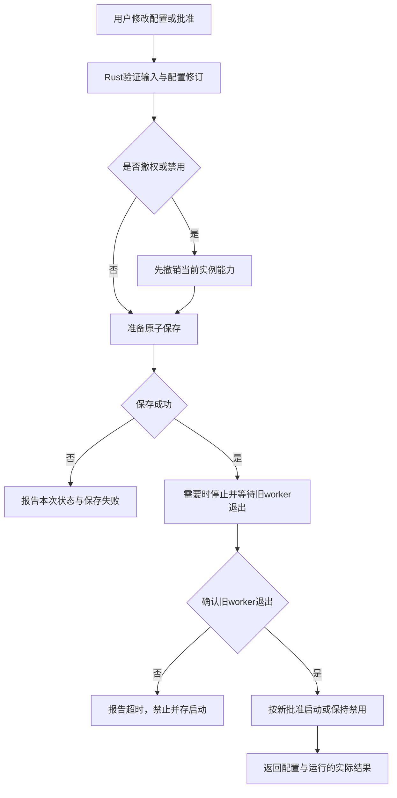
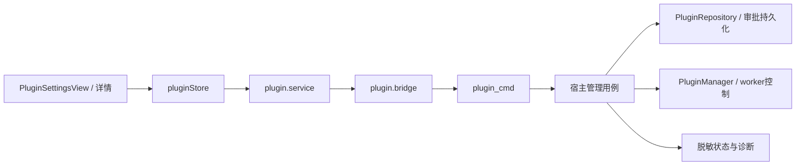

# 插件系统最小实现复盘与管理演进

核对日期：2026-10-20。代码基线：`feat/plugin-runtime` / `e9b638f`，上一轮接口基线为 `2cef9a1`。本文对照实际代码整理，不把计划中的功能写成已实现。

当前已经有可供作者开发、加载和验证插件的最小宿主；距离非开发者可自行安装、授权、维护插件，还缺管理闭环、诊断能力和真实环境验收。下一步应优先补这些缺口，继续保持单文件 JS、简单启停和唯一 CoreEventBus。

本文只记录复盘和建议，不实施管理界面，不新增气球插件，也不改变现有授权和安全策略。全文的“建议”“拟新增”“验收”均属于后续工作。

## 1. 最小化的范围与保留的底线

本次最小化主要体现在产品范围和运行方式：没有插件市场、自动更新、暂停/恢复、依赖编排、WASM、插件自定义页面或在线 TypeScript 编译。一个插件就是一个清单、一份离线打包的 JS，以及宿主批准的有限能力。

访问范围、权限、在途取消、网络限制、持久化原子性和资源上限仍然保留。这些直接决定插件是否会串账号、误操作或影响比赛客户端，不能等管理页做完才补。

| 选择 | 当前做法 | 为什么适合当前项目 | 暂时不扩展什么 |
|---|---|---|---|
| 事件 | 唯一 CoreEventBus → PluginHost → 每插件有界队列 | 复用事实通知；慢插件不阻塞发布方 | 第二套业务总线、持久事件重放 |
| 运行 | 每插件一个 QuickJS 引擎和 worker 线程 | Promise、中断、有限能力注入已有成熟实现 | 多引擎、独立进程调度平台 |
| 生命周期 | starting / running / stopped / failed | 足够表达本次加载和运行结果 | suspend、resume 等完整状态机 |
| 发布物 | 一份 ES module，TS 在宿主外构建 | 依赖离线打包，入口和加载边界容易检查 | 运行时任意 import、原生模块 |
| 配置与授权 | 代码之外的 plugins.json | 声明和审批分开；默认不执行插件 | 配置表单、在线权限申请流程 |
| 数据 | 每插件 JSON，fs4 锁与 atomicwrites 替换 | 小规模状态、幂等标记不需要数据库 | 跨插件事务、通用数据库服务 |
| 网络 | 独立 reqwest、精确 origin、DNS/IP 检查 | 不复用 OJ Cookie/Token；支持明确批准的内网服务 | 任意代理、跳转和宿主隐式重试 |
| 开发入口 | dev 控制台助手 + 管理命令 + SDK | 先让作者真正跑起来 | 完整插件管理中心 |

Manifest 格式版本、Host API 版本、事件协议版本当前恰好均为 **2**，三者语义仍然独立；“插件系统 1.0”不要求这些字段都填 1。

## 2. 各阶段做了什么、还缺什么、怎么改进

这里按架构层重新归纳阶段。实际提交也遵循先引擎可行性、再基础层和能力层、最后开发入口的顺序；阶段不是要求以后继续扩张的生命周期状态。

### 阶段 0：真实代码审计和引擎可行性

**已经完成。** 记录增量审计，确认上一轮主要是契约和事件边界；识别 AuthService.get_session 会恢复凭证、比赛加载会选赛、提交详情含源码、Hydro 原分页推断不适合证明历史完整等实际约束。引入 rquickjs 0.14 的 std/futures，真实验证 Windows 上 ES module、Rust Future/JS Promise、死循环中断、内存限制和缺少默认文件/进程/网络能力。

**仍有缺口。** 没有跨操作系统构建验证，没有三个候选引擎的包体积、启动耗时和资源基准。引擎版本维护与安全更新尚未形成固定流程。当前隔离在同一进程中，不能隔离 native 引擎缺陷导致的进程崩溃。

**改进方式。** 先为现有引擎补可复现的 Windows 构建/测试 CI 和依赖升级检查，再按实际发布平台补矩阵。记录一个、多个插件时的包体积、启动时间、进程内存和空闲开销。除非数据表明不适合，否则继续使用 QuickJS；分发不受信任的第三方插件时，再单独评估进程隔离。

证据：[审计](plugin-architecture-review.md)、[引擎测试](../src-tauri/src/plugin/runtime/tests/engine_tests.rs)、[运行时说明](modules/src-tauri/plugin/runtime/mod.md)。

### 阶段 1：访问作用域和只读 Service 基础层

**已经完成。** 新增通用 AccessRevision，登录、登出、会话失效、OJ/比赛变化和连接配置变化显式撤销旧读取，不依赖可能丢失的事件。处理切走再切回的 ABA、在途请求、持久化失败后仍已生效的变化。新增只读身份、比赛元数据和本人提交历史路径；实际 OJ endpoint 来自 Provider 注册元数据。会话删除失败后，插件查询仍遵守内存中的身份撤销。

**仍有缺口。** 作用域正确性要求今后新增的变更入口继续接入同一 fence，目前主要靠接口约定和回归测试维持。改 OJ 地址不会热重建 Provider，配置地址与实际连接不一致时插件查询返回 unavailable。身份是本地保存的稳定用户记录，不是每次向服务端重新认证的结果。

**改进方式。** 保留通用 fence，不把它改成插件专属核心逻辑。为新增账号/连接入口建立小型契约测试；管理页把“连接配置待重启生效”“未登录”“上下文刚失效”区分展示。只有项目确实需要热换连接时，才实现统一的 Provider 重建与切换流程，禁止由插件绕开现有 Service 编排。

证据：[AccessRevision](../src-tauri/src/core/access.rs)、[ServiceQueries](../src-tauri/src/plugin/query.rs)、[AuthService](../src-tauri/src/service/auth/mod.rs)。

### 阶段 2：协议、安全投影和 Plugin API Adapter

**已经完成。** 清单/API 升到 v2：网络采用精确 origin，提交列表采用不透明游标和可空 total。插件通过当前作用域访问身份、比赛和本人提交元数据，API 不返回内部实体、源码或凭证。查询前后校验并监听取消。游标保留 native page 剩余记录、绑定 context 和查询条件；HOJ 使用原生分页，Hydro 继续到真实空页。补上 metadata 查询成功提前返回时的游标释放和 scope 读取期间撤销的回归。

**仍有缺口。** `submission.get` 为避免读取源码，要扫描本人比赛历史，最多 100 次 API 页；大历史查询成本高。跨页没有快照一致性，新提交/重判可能导致重复或移位。本人二次校验依赖列表的 username，而不是内部 owner ID；适配器字段缺失或展示名规则变化可能导致保守拒绝。每次 `context.current()` 都签发新句柄，最多保留 32 个且有效期 5 分钟；高频事件里每次重新申请可能先撞到数量限制。没有 API 兼容性自动对照和便利的分页开发工具。

**改进方式。** 优先在 OJ 确有可靠接口时增加“仅元数据、含 owner/contest 校验”的 Provider 查询，默认仍走保守扫描；不要复用含源码详情再裁剪。保留 `total=null` 和明确的超限错误。对相同有效作用域可复用句柄或增加显式释放，失效后重新获取，并补高频调用测试。之后提供有预算、可取消、去重示例的 SDK 分页工具，并用契约测试对照 Rust DTO、桥和 TypeScript 声明；需求少时无需自建代码生成框架。

证据：[查询 Adapter](../src-tauri/src/plugin/query.rs)、[提交 API](modules/src-tauri/plugin/api/submission.md)、[SDK](modules/src-tauri/plugin/sdk/hinina.d.ts)。

### 阶段 3：存储、HTTP 和通知

**已经完成。** 插件数据与代码分离；JSON key 只是数据，namespace 由宿主绑定。fs4 锁覆盖读/比较/写，atomicwrites 完成后才确认 CAS 成功；缺失和 JSON null 分开，损坏文件保留并报错。网络用独立 reqwest，无 OJ 凭证、Cookie、代理、跳转或隐式重试，全部 DNS 答案校验后固定连接，并检查实际 remote address。请求/响应体、总超时、并发、速率均受限，私网和 HTTP 需要额外批准。通知经过前端完整分层，用文本插值渲染。

**仍有缺口。** JSON 每次事务读取文件，写入时重写整体，适合小状态而非高频大数据。没有备份、损坏恢复、数据导出/删除管理。`options` 和私有 JSON 都不是秘密保险箱，插件若需要外部服务密钥，目前没有专用凭据引用。HTTP 没有完成 JS 经生产策略到真实成功服务的全链路验收，也没有受控 DNS 重绑定演练。通知易失，不能保证前端已显示。

**改进方式。** 继续用 JSON，先补数据占用、备份和显式恢复；只有写放大或容量成为实测瓶颈时再考虑 SQLite 等成熟方案。密钥需求明确后复用操作系统凭据库，前端仅管理引用与替换，不能把密钥写进普通 options。网络先补可注入 resolver/transport 的生产路径测试和测试环境联调，不能为测试开放 loopback 豁免。通知与运行诊断分离，派发成功依据由插件和外部服务确认。

证据：[存储](../src-tauri/src/infra/plugin_storage.rs)、[HTTP](../src-tauri/src/infra/plugin_http.rs)、[HTTP 测试](../src-tauri/src/infra/tests/plugin_http_tests.rs)、[文本通知](../src/components/PluginNotifications.vue)。

### 阶段 4：文件仓库、运行时和简单生命周期

**已经完成。** 仓库读取宿主批准，校验清单、版本、重复目标 ID、canonical 入口边界和源码大小。授权取批准与声明交集。Manager 为插件创建独立 worker/引擎，使用持久 Tauri Tokio handle；串行 handler、引擎中断、Promise 取消、内存/栈/执行时间预算均已接入。停止先撤销再注销，重载等待旧 worker 退出。桥在创建 Future 前占用配额，避免同步批量 Promise 绕过 16 个在途调用限制。

**仍有缺口。** 授权主要绑定插件 ID，没有绑定已审阅的代码内容或发布物摘要；同 ID 替换代码后可以沿用原批准能力。管理状态仅有 id/state/error，文件校验失败等早期启动错误不一定完整留在状态中。所有插件的生命周期操作共用一把异步锁，自动启动依次等待，多个慢激活会拉长插件启动总时长。缺少全局资源预算；16MiB 是引擎堆限制，不是该插件所有 Rust 分配、线程及进程开销的硬上限。

**改进方式。** 正式安装流程先引入发布物摘要和待生效版本，更新展示能力变化；摘要用于绑定本次审阅内容，不自动证明作者可信。为状态增加安全诊断和操作时间，使用内部枚举并统一早期失败记录。单插件/全局资源先测量再设预算。只有生命周期串行等待成为问题时才换成按插件锁 + 有限启动并发；继续避免复杂状态机和自动无限重启。

证据：[仓库](../src-tauri/src/infra/fs_plugin_repo.rs)、[Manager](../src-tauri/src/plugin/manager.rs)、[QuickJS](../src-tauri/src/plugin/runtime/quickjs.rs)。

### 阶段 5：开发入口、装配和重新同步

**已经完成。** Tauri 已装配自动加载；只有显式 enabled 的插件尝试启动，单插件失败不阻止应用。提供 list/start/stop/reload/resync，dev 助手经 Store → Service → Bridge 调用；有 TypeScript 声明、通用脚手架和离线 bundle 脚本。默认 60 秒 Resync，可配 10..3600 秒；初始、Lagged、账号/OJ/比赛变化也可提示重查。退出只撤销，不干扰核心工作区落盘。

**仍有缺口。** 没有管理页和配置写入命令；需要手改 plugins.json。stop 不写 enabled，因此重启可能再自动启动；手改 enabled/权限也不即时撤销已运行实例。配置整体解析/验证失败会影响本轮自动加载；list 读取配置出错时可能只返回已有内存状态，用户难以看出原因。Resync 调用成功只代表宿主接受提示；队列已有消息时会跳过本次入队，并非同步完成确认。在持续积压时重新同步可被延后。

**改进方式。** 管理层区分“本次运行状态”和“持久启用意图”，新增原子配置写入与明确应用结果。保留最后可用配置并逐条报告无效项，不能静默显示空列表。后续可用一个 pending-resync 标记，在 worker 交付边界合并处理，避免一直等空队列；仍不建立第二套总线、不重放业务事件。UI 用“已请求重新同步”，不能写“派发已重试成功”。

证据：[开发命令](../src-tauri/src/commands/plugin_cmd.rs)、[Host 合并逻辑](../src-tauri/src/plugin/host/plugin_host.rs)、[Store](../src/stores/pluginStore.ts)、[教程](modules/src-tauri/plugin/tutorial.md)。

### 阶段 6：验证、文档和交付

**已经完成。** 本轮交付时 Rust 与前端测试全部通过（最近一次的具体数量以[验证记录](modules/src-tauri/plugin/validation.md)为准，不在此重复），Clippy 仅保留原有 6 条警告；前端构建、SDK 类型和离线打包检查通过。真实引擎和 worker 覆盖异常隔离、停止死循环/悬挂 Promise、事件/查询/CAS/通知/重载、周期 Resync 和桥配额；专用 HTTP transport 使用 Mock Server 验证响应、跳转拒绝、体积、超时和取消。手册、架构、模块规范、todo 已同步。

**仍有缺口。** 没有完整桌面人工视觉验收、真实 HOJ/Hydro + 测试外部服务全链路验收、跨平台 CI 和长期压力测试。真实 JS 集成验证了未批准 HTTP 拒绝，成功 HTTP 主要在传输层测试，不能称已完成气球业务端到端。测试总数是全仓结果，不是新增插件测试数。

**改进方式。** 先做一个与业务无关的测试插件，经真实宿主路径连接专用测试服务，覆盖正常、超时后远端成功、进程重启、换账号、换比赛、历史分页变化和权限撤销；不向生产服务派发。界面交付再补交互/截图/键盘验收。CI 固定执行已有测试与 SDK 检查，失败即阻断发布。

证据：[验证记录和限制](modules/src-tauri/plugin/validation.md)。

## 3. 原参考设计与本次实现的差异

| 参考设计 | 本次取舍 | 之后更好的方向 |
|---|---|---|
| discover/validate/load/activate/suspend/unload 等生命周期 | 只实现必要加载步骤，运行状态四种 | 将安装有效性、配置意图、运行结果分别展示；不把所有概念塞进一个生命周期枚举 |
| hostname allowlist、默认 HTTPS | 精确 origin；私网和 HTTP 额外批准 | 用结构化网络授权编辑器；不把关闭 HTTPS 作为全局开关 |
| 按页查询和 listRecent | scope-bound cursor，total 可空 | 接真实 OJ 证据优化查询；保留未知、不完整和超限语义 |
| 查询提交详情判断身份 | 本人历史元数据查询，避免源代码详情 | 引入可靠的 metadata-only Provider 方法，校验 owner/contest |
| 事件一到即驱动业务 | 事件只提示，周期 Resync 补查询 | 插件有预算地扫描并恢复；核心不负责派发 |
| CAS(null) + dispatching 标记 | 宿主区分 missing/null，提供原子 CAS | 插件设计失败、租期和恢复状态；远端用同一幂等键确认重复请求 |
| 一次性实现业务插件与完整宿主 | 宿主可运行，提供通用开发起点 | 先完成作者环境联调，再让业务作者实现和验收气球逻辑 |

“第一次 AC”仍需先明确业务定义：当前账号对当前比赛某题的第一次可见 AC、是否包含赛前/赛后提交、如何处理重判、同时间提交如何排序。用户本人查询不能证明“全场所有队伍的第一次 AC”。这些差异不能靠加一个 Accepted 事件解决。

## 4. 优先级：先闭环，再扩大分发

以下不是把所有未实现项都列为阻塞；按实际使用范围设置门槛。

| 优先级与适用范围 | 工作 | 完成后解决什么 |
|---|---|---|
| P0：作者联调期间 | 真实宿主 → 测试 OJ/外部服务验收，分页变化/切换/重启/超时场景 | 证明本次能力确实支持目标工作流 |
| P0：管理页上线前 | 持久启用/禁用、原子授权/配置写入、撤权时显式停止和重新装配 | 用户操作能保存、能撤销，界面不会假装生效 |
| P0：管理页上线前 | 插件目录盘点、配置损坏/无效项诊断、早期加载失败记录 | 能区分未安装、未启用、审批不足、启动失败 |
| P0：管理页上线前 | 登录前/非比赛时可访问管理入口 | OJ 登录失败或插件启动失败时仍能恢复 |
| P0：提供更新/导入前 | 安装内容验证、已审阅发布物摘要、更新差异和失败保留旧版本 | 换代码不会被当成同一份已审阅内容 |
| P1：小范围日常使用 | 配置表单最小子集、诊断列表、数据占用/备份、Resync pending 标记 | 降低手改文件和排障成本 |
| P1：有密钥需求时 | 系统凭据库及秘密引用，不进 options/导出/日志 | 外部服务凭据有独立管理路径 |
| P1：多个插件时 | 全局预算、启动耗时测量、按需改进操作串行等待 | 防止单插件限制叠加后拖慢客户端 |
| P2：实际需要时 | 标准化包导入/回滚、更多平台、限额内存日志 | 提升分发和维护体验 |
| P2：不受信任分发前重新评估 | 独立进程、来源验证/签名策略、漏洞响应 | 为更宽的信任边界制定独立方案 |
| 暂缓 | 插件市场、远程代码热更、依赖求解、自定义 UI、WASM、通用工作流引擎 | 当前气球类外围扩展没有足够需求支撑成本 |

## 5. 插件管理界面应该包含什么

### 5.1 入口与角色

推荐提供“设置 → 插件”，同时在登录/赛前入口放一个“插件管理”入口，共用同一管理页面或抽屉。现有设置路由在比赛工作台之内，继承登录与比赛阶段守卫；直接把唯一入口塞进去，会让 OJ 登录失败时无法停用插件。

新增应用级入口只打开宿主管理能力，不放宽比赛、身份和提交 API 的授权。第一版面向本机维护者/插件作者；若部署方需要区分选手和管理员，应在宿主侧实现独立管理授权。OJ 账号登录、隐藏按钮、前端路由守卫都不是本机管理授权机制；不要假装已有管理员角色。

比赛中允许查看状态和停止异常插件；导入、更新、扩权、删除数据属于维护操作，默认放到明确的维护流程中。是否锁定赛中变更由部署方决定，不在本轮凭空引入一套组织/账号系统。

### 5.2 信息结构

第一版只需一个列表、一个详情页/抽屉和少数专门的操作对话框，无需单独建设插件门户。

```text
插件管理
  全局配置异常/维护状态                         [刷新]
  搜索                状态筛选                  [开发者入口]

  名称 / 版本          自动启用   本次状态          操作
  比赛辅助 1.0.0       已启用     运行中            详情  更多
  通用工具 0.2.0       未启用     已停止            详情  更多
  开发插件 0.1.0       已启用     启动失败          查看原因

  详情
    概览：版本、来源、运行结果、上次操作、需处理的问题
    权限与网络：声明 / 批准 / 当前生效，origin及内网范围
    配置：插件选项、Resync间隔、保存后生效方式
    诊断：最近错误、安全操作记录、导出脱敏诊断
    数据与开发：占用、备份、移除；开发目录/构建信息
```

“导入插件”在安装验证和批准绑定完成后再显示为可用操作；不能先画一个按钮，背后只做随意复制文件。首版可以只管理已有目录中的插件。

### 5.3 列表：让用户知道该做什么

| 必要信息 | 展示原则 |
|---|---|
| 名称、版本、ID | 名称优先；ID在详情或辅助文本，避免要求普通用户识别长ID |
| 自动启用意图 | 独立开关，明确表示重启后是否自动加载 |
| 本次运行结果 | 运行中、启动中、已停止、失败；失败附可理解的原因与下一步 |
| 配置/审批状态 | 尚未批准、待应用变更、版本不兼容、清单无效等是管理信息，不伪装为JS运行状态 |
| 最近结果 | 上次启动/停止时间、最近错误；没有数据时显示“暂无”，不捏造“健康” |
| 操作 | 启用/禁用、详情、停止/重启；低频维护操作放更多菜单 |

当前 `PluginStatus` 只有 id/state/error，列表来自配置与内存 worker，不是完整目录 inventory。因此完整列表需要新的安全投影；不能只用前端拼装现有返回值。

初期没有 OJ 会话或当前比赛时，插件本身仍可能处于 running。可展示“查询条件未就绪”；不得把“正在运行”解读为“气球已派发”或“正在读取比赛”。业务完成状态只有未来插件自愿通过经过规范的摘要接口提供时才能显示，宿主不能猜测。

### 5.4 权限和网络：同时看见请求、批准与生效

权限区按用途解释，例如“读取当前用户可见的提交记录”“保存插件自己的状态”“向指定服务发送请求”。展示三个集合：清单声明、宿主批准、本次实例实际生效的交集；存在待应用变更时明确标识。

网络列表显示精确协议/域名/端口。对私网服务，单独填写并批准 CIDR；HTTP 明文也单独批准，不能用一个“允许网络”开关替代。loopback、link-local 等禁止目标在高级模式也不开放。

已有 host/URL/CIDR 解析规则继续在 Rust 强制执行。可以提供“校验配置”“检查地址策略”，后者如需DNS必须由Rust执行；普通批准和保存不发送外部业务请求。未来连接测试必须说明请求对象、方法和副作用，不能拿生产派发 POST 当探活。

减少日常打扰：查看状态、停止、请求重新同步无需重复审批弹窗。增加能力、扩大网络范围、导入新代码时展示一次明确的差异审阅。插件更新不静默扩权；拒绝新能力时允许按原批准交集运行，但应说明插件可能因缺权限失败。

### 5.5 配置：先最小表单，再考虑复杂 schema

第一版提供 Resync 间隔、明确的插件选项编辑和错误定位。通用 options 可先保留高级 JSON 编辑器，普通用户使用的插件再增加最小 JSON Schema 子集：object、string、boolean、number、enum、required、范围和长度。采用成熟校验器，不自写 schema 引擎，不允许 schema 引用远程地址或注入脚本。

当前清单只接受 `configSchema={}`；支持非空 schema 是未来契约变更，需要版本/兼容策略及测试，不能只加前端控件。配置与授权分开：填写 endpoint 不能顺带批准该 origin。秘密字段不能混进普通 JSON。

保存按钮应使用“保存并应用”并展示结果：已持久化且新实例运行、已保存但重启失败、停止超时所以未加载新实例、磁盘保存失败。不能用一个“成功”toast掩盖部分成功。

### 5.6 诊断和数据：帮助恢复，同时保护幂等状态

诊断至少提供阶段、稳定原因码、发生时间、一次操作的关联ID，以及可执行建议。可由宿主提示“入口文件缺失”“API版本不兼容”“读取提交权限未批准”“网络地址未获批准”；给插件脚本的错误仍保持现有安全白名单。插件可控制的消息要限制长度、限流、按纯文本展示，禁止展示内部Rust堆栈和凭证。

当前请求ID在API完成时生成，event字段为空，CAS日志权限标注也未完整表达读写要求；这些字段还不足以还原一整次handler。后续应在事件交付/请求入口建立贯穿调用的安全关联上下文，记录耗时、失败阶段和限额结果，不记录完整body/响应、Token、用户名、源代码或本地绝对路径。先用tracing与有界诊断记录，暂不做复杂监控平台。

数据页显示占用、配额和上次写入时间；只有真正采集了这些信息才能展示。默认停止、禁用和移除代码都保留私有数据。导出、备份或删除由宿主专门命令执行，不给JS新增任意文件能力。导出文件可能包含插件业务数据，需要明确用户触发和导出范围。

对气球类插件，删除幂等标记可能再次派发；数据重置必须先停止、明确说明影响，并单独确认。不要把“清插件数据”混在“清应用缓存”或“修复运行”按钮里。损坏数据先保留原件和备份，不能自动创建空库伪装恢复成功。

## 6. 操作语义：比按钮数量更重要

| 操作 | 持久配置 | 本次运行 | 私有数据 | 用户应看到什么 |
|---|---|---|---|---|
| 启用 | enabled=true | 校验并启动 | 保留 | “已启用，运行中”或“已启用，启动失败” |
| 禁用 | enabled=false | 显式撤权、停止；以后不自动启动 | 保留 | 生效结果；停止异常单独提示 |
| 停止 | 不改变自动启用意图 | 撤权、停本次worker | 保留 | “已停止，下次启动应用仍自动启用” |
| 启动 | 使用现有批准；默认要求已启用 | 启动一个实例 | 保留 | 校验/启动结果 |
| 重启/重载 | 应用当前代码、配置和批准 | 先停旧实例、确认退出、再启动 | 保留 | 失败阶段；不能出现两个实例同时运行 |
| 请求重新同步 | 不变 | 合并一个提示，交由handler重查 | 由插件决定 | “已请求”，不承诺即时完成或业务重试成功 |
| 修改权限/网络 | 原子写入新批准 | 撤权优先；重新装配交集 | 保留 | 新批准与当前生效是否一致 |
| 更新代码 | 绑定待安装版本和审阅差异 | 安全切换、失败保留可恢复版本 | 默认保留 | 版本、能力变化、应用结果 |
| 移除插件 | 删除相应启用/批准记录 | 先撤权停用，再移除受管代码 | 默认保留 | 是否保留数据；同ID重装的继承规则 |
| 删除私有数据 | 不扩大批准 | 先停止，成功后由用户决定是否再启动 | 显式删除 | 不可逆影响，尤其是去重记录 |

当前已经有的只有本次 start/stop/reload/resync 和只读 list；表内持久写入、更新、移除、数据维护是拟新增能力。

**应用一致性建议：** 禁用和撤权优先终止当前能力，然后可靠保存；如果磁盘写失败，本次保持撤销并明确提示“本次已停止，下次启动的配置尚未保存”，提供重试。新增授权则必须先验证与成功保存，再签发新实例；停止超时禁止开启替代实例。UI只能按后端返回的复合结果展示，不自行推断成功。

配置写入需版本号或等价的乐观并发控制，避免两个页面/编辑器覆盖彼此修改。该版本号属于宿主管理配置，不应再向插件 Manifest 增加一组语义重复的 version 字段。外部手改文件仍需刷新验证；未来可以提供显式“应用磁盘配置”，不默认引入自动watch和热更新。



## 7. 分层施工建议与成熟生态

管理界面应消费管理服务，继续遵守现有边界：



“宿主管理用例”是职责建议，可以先作为 `plugin/management` 的小模块，不要求新造框架。Core/业务Service继续不依赖plugin；JS的Plugin API也不增加安装、审批、修改其他插件或管理宿主的能力。文件、网络和配置写入仍在Rust。

| 层 | 推荐新增或补强 | 暂缓的复杂度 |
|---|---|---|
| 管理契约 | 目录inventory、声明/批准/生效投影、失败阶段、配置修订、操作复合结果 | 任意JS对象或内部结构直接序列化 |
| 仓库/配置 | 逐插件诊断、原子写、修订冲突、最后可用配置；复用atomicwrites/fs4 | 自建事务数据库、任意文件写命令 |
| Manager | 持久禁用/撤权用例、早期失败记录、待应用状态、按需全局预算 | 完整生命周期框架、无限自动重试 |
| Command/前端 | 小而明确的管理命令；用项目现有Vue/Pinia/Naive UI组件 | 新建独立前端插件平台 |
| 选项配置 | 成熟JSON Schema校验器、受支持子集、宿主复验 | 自制schema语言、任意脚本表单 |
| 发布物 | 标准库/成熟归档库处理有限格式；限制路径、大小、条数、符号链接 | 手写ZIP解析、自动下载执行、市场 |
| 秘密存储 | 有需求时接系统凭据库，管理引用 | 自研加密/密钥轮换系统 |
| 诊断与测试 | tracing、现有Vitest/Rust测试、可注入网络依赖、成熟CI | 自研监控、测试专用生产安全后门 |

新增能力前先校验依赖体积、Windows兼容性和维护状态。成熟库负责底层机制；审批交集、作用域撤销、origin策略、业务幂等等产品规则仍需本项目明确实现和验证。

## 8. 后续迭代及验收门槛

| 迭代 | 交付范围 | 主要验收 |
|---|---|---|
| A：宿主联调与管理基础 | 专用测试环境、inventory/诊断、持久启用禁用/审批写入 | 换账号/OJ/比赛、重启、失败保存、撤权在途调用、配置损坏；不依赖通知保证安全 |
| B：最小管理页面 | 登录前入口、列表/详情、启用禁用、状态/权限/网络、重新同步、基础配置 | 无OJ会话可停插件；stop与disable语义正确；操作进行中防重复；键盘/读屏/视觉验收 |
| C：本地分发与数据维护 | 导入预检、版本和能力差异、受管更新、备份和保留数据的移除 | 路径逃逸/归档炸弹/重复ID/摘要不匹配/更新失败/数据保留；撤权与替换不得扩权 |
| D：按反馈增强 | schema子集、凭据引用、有限诊断历史、资源测量与预算 | 不泄密、schema不联网、限流/配额可解释、长期运行与发布平台CI |

管理列表可用低频查询和窗口重新聚焦刷新。后续若加状态通知，通知只触发重查；状态真值仍由后端查询返回，无需新的业务事件总线。

优先验收的用户场景包括：禁用后重启不再运行；权限取消立即撤销旧实例；保存失败不显示已生效；一个清单/配置项损坏不掩盖其他状态；插件异常与核心提交/关窗互不影响；更新后不静默扩权；删除代码不清除业务幂等数据；没有完整历史时不声称首次AC。

## 9. 气球插件目标的责任划分

| 责任方 | 当前具备 | 还需要做 |
|---|---|---|
| Hinina宿主 | 安全事件、本人身份/当前比赛/提交历史、CAS、受控HTTP、通知、Resync | 真实环境联调；上述管理闭环和诊断补强 |
| 插件作者 | 可用SDK、单文件入口和通用脚手架 | 明确首次AC定义，预算化扫描/去重/排序，持久状态与恢复、限次重试，外部幂等键 |
| 外部气球服务 | 本轮没有实现或验收 | 接收并持久识别幂等键、重复请求返回同一业务结果；明确超时/500语义，最好支持查询派发结果 |
| 维护者 | 可手工批准指定origin/私网和能力 | 设置测试/生产服务边界，安装和更新审阅，异常停用与数据保留策略 |

宿主的30秒handler预算不应通过一次性放大到几分钟解决大历史问题。插件应拆分扫描和恢复进度；如果实际OJ无法提供足够可见历史，先补可靠查询契约或让业务保守不派发，不在核心SubmissionService里加入首次AC判定。

本次实现已满足“让插件开始开发”的工程起点。后续首要目标是可验证地使用、可解释地失败、可可靠地停用与恢复；上述管理迭代完成之前，继续按作者/维护者参与的开发模式使用。
